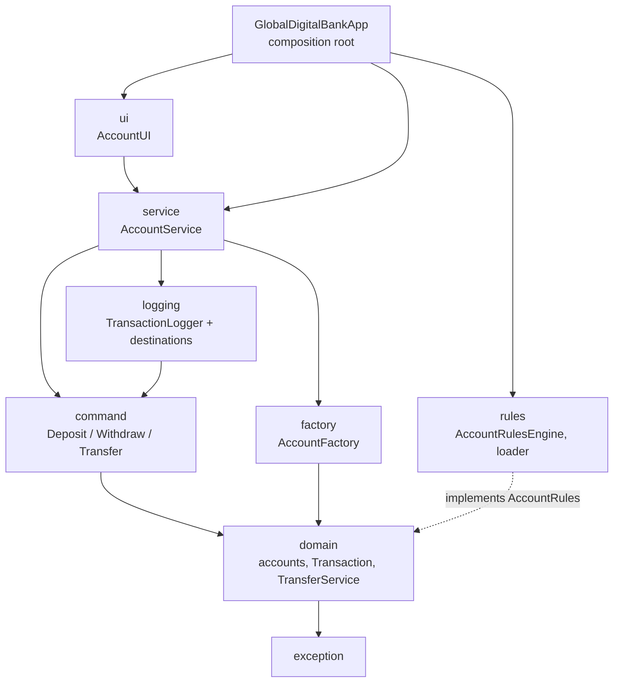

# Architecture

## Layers

Rules of the road:

- `domain` depends only on `exception`. It defines the `AccountRules` interface and does no I/O.
- `rules` implements `AccountRules`; nothing in `domain` imports `rules`.
- `ui` talks only to `service`; it contains no banking rules.
- Only `GlobalDigitalBankApp` knows which concrete classes are used.

## Patterns and where they are used

| Pattern | Where | Why |
|---|---|---|
| Inheritance / template hooks | `AbstractAccount` and 4 product classes | One implementation of deposit, withdraw, PIN, lifecycle; products override `availableFunds` / `checkWithdrawalRules` |
| Interface | `IAccount`, `AccountRules`, `LogDestination`, `TransactionCommand` | Callers and tests depend on behaviour, not classes |
| Factory | `AccountFactory` | Creates the right product from an `AccountType` or text |
| Singleton | `AccountRulesEngine` | One shared, reloadable rule set |
| Command | `command/` | Each banking action is an object that can be executed once and logged |
| Bridge | `TransactionLogger` + `LogDestination` | Logging front-end independent of file / memory / database back-end |
| Dependency injection | constructors everywhere | Tests inject stub rules, fake clocks, in-memory logs |

## Key decisions

- **Rules as data.** Minimum balance, interest, daily limits and product features come from properties
  files with tenure tiers, so a rule change is a file edit. Reloads are all-or-nothing.
- **Validation at the edge of the domain.** Constructors and methods reject bad input
  (non-finite amounts, short PINs, under-18s) with specific exceptions.
- **Secrets stay out of the log.** `transient` fields plus an `ObjectInputFilter` allow-list.
- **Append-only log.** `TransactionLog` writes without repeating the stream header so entries can be appended
  across runs.
- **Thread safety.** The service, transfer service, logger and rules engine synchronise their public methods.

## Testing

`src/test/java` mirrors the main packages. `support/Fixtures` builds accounts and services with the real
packaged rules. Tests that touch files use temporary directories; tests that touch the rules singleton restore it afterwards.
